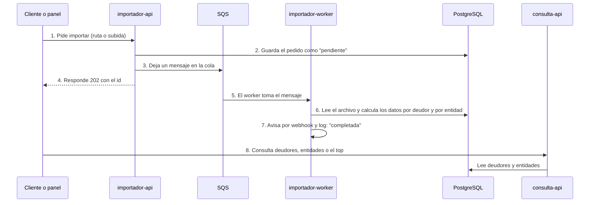

# Padrón de deudores BCRA

Microservicios .NET 10 que importan el padrón de deudores del sistema financiero del BCRA (`deudores.txt`, ~5,9 GB y 34 millones de líneas), calculan los datos por deudor y por entidad, avisan cuando terminan y permiten consultarlo por API o desde un panel web.

**Documentación complementaria:** [Arquitectura](docs/arquitectura.md) (cómo está armado) · [Decisiones](docs/adr/README.md) (por qué está hecho así: cada decisión, con las alternativas descartadas)

## Contenido

1. [Qué hace](#1-qué-hace)
2. [Quick start](#2-quick-start)
3. [Uso con el panel web](#3-uso-con-el-panel-web)
4. [Problemas frecuentes](#4-problemas-frecuentes)
5. [Uso con la API](#5-uso-con-la-api)
6. [Tests](#6-tests)
7. [Monitoreo](#7-monitoreo)
8. [Reglas de negocio](#8-reglas-de-negocio)
9. [Configuración](#9-configuración)
10. [Estructura del repositorio](#10-estructura-del-repositorio)
11. [Límites conocidos](#11-límites-conocidos)

---

## 1. Qué hace

1. **Recibe** el archivo: por ruta local (carpeta `data/`) o subiéndolo por HTTP (se guarda en S3).
2. **Procesa** cada línea en streaming (memoria constante, menos de 80 MB) y la carga en PostgreSQL con `COPY`.
3. **Calcula**, para cada deudor, su situación máxima y la suma de sus préstamos; y para cada entidad, el total prestado.
4. **Avisa** al terminar: log estructurado y un POST a un webhook.
5. **Expone** los resultados en una API de consulta y en un panel web.



| Servicio            | Puerto | Qué hace                                                                                                                                                                            |
| ------------------- | -----: | ----------------------------------------------------------------------------------------------------------------------------------------------------------------------------------- |
| `frontend`          |   5003 | Panel web: importar, seguir las importaciones y consultar                                                                                                                           |
| `importador-api`    |   5001 | Recibe los pedidos de importación, los guarda y los encola                                                                                                                          |
| `importador-worker` |      — | Toma los pedidos de la cola, procesa el archivo y actualiza los datos por deudor y por entidad                                                                                      |
| `consulta-api`      |   5002 | Consulta deudores, entidades y el top de deudores (usuario de base de solo lectura)                                                                                                 |
| `migraciones`       |      — | Crea y actualiza las tablas al levantar, y termina                                                                                                                                  |
| `postgres`          |   5432 | Base de datos                                                                                                                                                                       |
| `localstack`        |   4566 | S3 y SQS de AWS, emulados en local                                                                                                                                                  |
| `webhook-receptor`  |   8080 | Recibe el aviso de "importación terminada" (webhook) y lo muestra en su log. Ocupa el lugar de quien lo recibiría en la realidad: otra app, un canal de Slack, un servicio de mails |

La importación es **asíncrona**: la API responde enseguida (`202 Accepted`) y el worker procesa en segundo plano. Con el archivo real tarda unos **4 minutos**.

---

## 2. Quick start

Lo necesario para levantar el sistema y hacer una primera importación.

### 2.1. Requisitos previos

- [Docker Desktop](https://www.docker.com/products/docker-desktop/) (o Docker Engine con Compose v2), con **8 GB de memoria** asignados a Docker.
- Para correr los tests: el [SDK de .NET 10](https://dotnet.microsoft.com/download/dotnet/10.0) y, para los del panel, [Node.js 22](https://nodejs.org/).
- Para importar el archivo real: el `deudores.txt` de la Central de Deudores del BCRA (no se incluye en el repo). Para probar sin él, el repo trae una muestra de 5 líneas.

### 2.2. Puesta en marcha

```bash
git clone https://github.com/andifeliz/padron-deudores-bcra.git
cd padron-deudores-bcra
cp .env.example .env
docker compose up -d --build
```

Las credenciales (usuario, contraseñas y claves de AWS) salen **solo del `.env`**, que no se versiona. El `.env.example` trae valores de desarrollo listos para usar. Para cambiar otros valores, ver [Configuración](#9-configuración).

Verificá que todo esté arriba:

```bash
docker compose ps -a --format "table {{.Service}}\t{{.Status}}"
```

```
SERVICE             STATUS
consulta-api        Up About a minute (healthy)    ← funciona: responde y la base también
frontend            Up About a minute (healthy)    ← el panel responde
importador-api      Up About a minute (healthy)
importador-worker   Up About a minute              ← está corriendo
localstack          Up About a minute (healthy)
migraciones         Exited (0) About a minute ago  ← lo normal: creó las tablas y terminó sin errores
postgres            Up About a minute (healthy)
webhook-receptor    Up About a minute
```

Por último, poné en la carpeta `data/` el archivo que vas a importar. Para probar rápido, copiá la muestra de 5 líneas que trae el repo:

```bash
cp tests/PadronDeudores.IntegracionTests/Muestras/deudores-muestra.txt data/
```

Para el archivo real, copiá tu `deudores.txt` en `data/`.

Para apagar el sistema **conservando la base de datos** (al volver a levantar, siguen estando los datos importados):

```bash
docker compose down
```

Para **empezar de cero**, borrando también la base (después hay que volver a importar):

```bash
docker compose down -v
```

En los dos casos se pierden los archivos subidos a S3, porque LocalStack no los guarda en disco.

---

## 3. Uso con el panel web

Abrí **http://localhost:5003**. Arriba se ve si cada API está en línea.

| Sección           | Qué podés hacer                                                                                                                                                                                   |
| ----------------- | ------------------------------------------------------------------------------------------------------------------------------------------------------------------------------------------------- |
| **Importar**      | **Desde la carpeta de datos:** escribí el nombre del archivo de `data/` (por ejemplo `deudores-muestra.txt`). **Subir un archivo:** elegilo de tu computadora; se guarda en S3                    |
| **Importaciones** | Seguí el estado de cada importación (subiendo → pendiente → procesando → completada o fallida) y su resumen al terminar. Podés buscar una por su id; con **Ver todas** volvés a la lista completa |
| **Consultas**     | Buscá un deudor o una entidad, y mirá el top de deudores con filtro por situación. Los montos se muestran en pesos                                                                                |

**Para el archivo real, usá "Desde la carpeta de datos".** Si lo subís, se guarda una copia de 5,9 GB en LocalStack (el S3 que corre en tu máquina), que puede quedarse sin memoria y fallar (ver [Problemas frecuentes](#4-problemas-frecuentes)).

---

## 4. Problemas frecuentes

| Qué ves                                                                                                                        | Por qué pasa                                                                                                                                                    | Cómo se soluciona                                                                                                                                                                                                                 |
| ------------------------------------------------------------------------------------------------------------------------------ | --------------------------------------------------------------------------------------------------------------------------------------------------------------- | --------------------------------------------------------------------------------------------------------------------------------------------------------------------------------------------------------------------------------- |
| La subida falla ("Falló la subida", `500`) o una importación por subida queda `fallida` con *"The response ended prematurely"* | **LocalStack se quedó sin memoria** con un archivo muy grande: `docker compose ps -a` lo muestra `Exited (247)`. Es un límite del emulador; S3 real no lo tiene | `docker compose up -d localstack` para levantarlo de nuevo. Para el archivo real, importalo **desde la carpeta de datos**. Si igual necesitás subirlo, dale más memoria a Docker (Docker Desktop → Settings → Resources → Memory) |
| Todo empieza a fallar a la vez: servicios `unhealthy`, `500` en el panel, errores `input/output error`                         | **El disco está lleno.** Cada archivo subido queda copiado dentro de Docker (S3 de LocalStack), además de las imágenes y la caché                               | Liberá espacio: `docker compose restart localstack` (borra las copias de S3; las importaciones ya hechas siguen en la base) y `docker builder prune -f` (borra la caché de compilación).                                          |
| Una importación queda `pendiente` para siempre después de reiniciar LocalStack                                                 | LocalStack **no guarda las colas** al reiniciarse: el mensaje se perdió (con SQS real no pasa)                                                                  | Volvé a pedir la importación                                                                                                                                                                                                      |
| `docker compose up` falla con *"required variable … is missing a value: Falta … en el .env"*                                   | **Falta el `.env`**, o le falta una credencial                                                                                                                  | `cp .env.example .env` y volvé a levantar                                                                                                                                                                                         |
| `bind: address already in use` al levantar                                                                                     | **Otro programa usa el puerto** (5001, 5002, 5003, 5432, 4566 u 8080)                                                                                           | Cambiá ese puerto en un `.env` (por ejemplo `FRONTEND_PORT=5004`) y volvé a levantar                                                                                                                                              |
| Después de reiniciar Docker Desktop, los servicios quedan apagados                                                             | Docker no vuelve a prender los servicios después de reiniciarse                                                                                                 | `docker compose up -d`                                                                                                                                                                                                            |
| `npm install` en `frontend/` falla con *"Cannot read properties of null (reading 'edgesOut')"*                                 | Un error de npm 11.1                                                                                                                                            | Actualizá npm: `npm install -g npm@11.21.0`                                                                                                                                                                                       |

---

## 5. Uso con la API

Hay dos APIs: la **Importador API** (`localhost:5001`) recibe y sigue las importaciones, y la **Consulta API** (`localhost:5002`) consulta los resultados.

| Método | Endpoint                            | Qué hace                                            |
| ------ | ----------------------------------- | --------------------------------------------------- |
| POST   | `localhost:5001/importaciones`      | Importa un archivo de la carpeta `data/` (por ruta) |
| POST   | `localhost:5001/upload`             | Sube un archivo y lo importa                        |
| GET    | `localhost:5001/importaciones/{id}` | Estado y resumen de una importación                 |
| GET    | `localhost:5002/deudores/{cuit}`    | Situación máxima y suma de préstamos de un deudor   |
| GET    | `localhost:5002/entidades/{codigo}` | Suma de préstamos de una entidad                    |
| GET    | `localhost:5002/deudores/top/{n}`   | Los N deudores con mayor suma de préstamos          |

- Los montos están **en miles de pesos**, como en el archivo del BCRA: por ejemplo, `"sumaTotalPrestamos": 261.0` son \$ 261.000.
- Los errores siguen el formato estándar [Problem Details (RFC 9457)](https://www.rfc-editor.org/rfc/rfc9457), con un mensaje que explica qué pasó.
- Cada API tiene su documentación interactiva (OpenAPI), con un botón para probar cada endpoint desde el navegador: http://localhost:5001/scalar y http://localhost:5002/scalar.

### 5.1. Importar desde la carpeta de datos · `POST /importaciones`

Importa un archivo que ya está en la carpeta `data/` del proyecto (ver [Puesta en marcha](#22-puesta-en-marcha)): le pasás **solo su nombre**, y la API lo lee de ahí. No hace copias del archivo, así que es la opción para el archivo real.

**Recibe:** `{"archivo": "<nombre del archivo>"}`. Solo el nombre, sin carpetas.

```bash
curl -i -X POST localhost:5001/importaciones -H "Content-Type: application/json" -d '{"archivo":"deudores-muestra.txt"}'
```

**Responde** enseguida, sin esperar a que se procese el archivo:

```
HTTP/1.1 202 Accepted                                                ← "recibí tu pedido, lo voy a procesar"
Location: /importaciones/01a17652-ddf3-773d-9389-35afec4895cb        ← la dirección de la importación creada: un GET ahí muestra su estado

{"id":"01a17652-ddf3-773d-9389-35afec4895cb","estado":"pendiente"}   ← el id de tu importación
```

El procesamiento sigue en segundo plano; su estado se consulta con el id (ver [5.3](#53-seguir-una-importación--get-importacionesid)).

**Errores:** `400` si el nombre incluye carpetas · `404` si el archivo no está en `data/`.

### 5.2. Subir un archivo e importarlo · `POST /upload`

Recibe **el archivo entero** dentro del pedido, desde cualquier carpeta de tu computadora. La API lo guarda en S3 y lo importa desde ahí. Es la opción cuando el archivo no está en la carpeta de datos del servidor.

**Recibe:** el contenido del archivo (`application/octet-stream`) y, opcional, `?nombre=` con su nombre (si no se indica, `deudores.txt`). Hasta 8 GiB: el máximo se cambia en el `.env`, con la variable `UPLOAD_MAXIMO_MIB`, en MiB (`8192` MiB = 8 GiB). Ver [Configuración](#9-configuración).

```bash
curl -i -X POST "localhost:5001/upload?nombre=deudores-muestra.txt" -H "Content-Type: application/octet-stream" --data-binary @data/deudores-muestra.txt
```

**Responde** cuando el archivo terminó de subir (con uno grande puede tardar unos minutos), igual que la importación por ruta (ver [5.1](#51-importar-desde-la-carpeta-de-datos--post-importaciones)): `202 Accepted`, con el id y la dirección para seguir el estado. El procesamiento sigue en segundo plano.

**Errores:** `400` si el archivo está vacío o el nombre incluye carpetas · `413` si supera el tamaño máximo.

### 5.3. Seguir una importación · `GET /importaciones/{id}`

Devuelve el estado de una importación y, cuando termina, su resumen. El estado pasa por `pendiente` → `procesando` → `completada` (o `fallida`, con el motivo en `error`).

**Recibe:** el id que devolvió el pedido de importación.

```bash
curl -s localhost:5001/importaciones/01a17652-ddf3-773d-9389-35afec4895cb
```

**Responde:**

```json
{
  "id": "01a17652-ddf3-773d-9389-35afec4895cb",
  "origen": "ruta",
  "archivo": "/data/deudores-muestra.txt",
  "estado": "completada",
  "creadaEn": "2026-10-26T03:48:24.692359Z",
  "iniciadaEn": "2026-10-26T03:48:24.713164Z",
  "finalizadaEn": "2026-10-26T03:48:24.726294Z",
  "resumen": {
    "importacionId": "01a17652-ddf3-773d-9389-35afec4895cb",
    "lineasLeidas": 5,
    "lineasInvalidas": 1,
    "deudores": 4,
    "entidades": 2,
    "lineasPorPeriodo": { "202310": 1, "202311": 3 },
    "codigosSituacionDesconocidos": {},
    "duracionSegundos": 0
  },
  "error": null
}
```

`origen` dice cómo se pidió la importación, y `archivo`, de dónde se lee:

| `origen` | Cuándo                                       | `archivo`                                                                                                                                   |
| -------- | -------------------------------------------- | ------------------------------------------------------------------------------------------------------------------------------------------- |
| `ruta`   | Se pidió por ruta, desde la carpeta de datos | Dónde lo leyó: `/data/{nombre del archivo}` (ej.: `/data/deudores.txt`)                                                                     |
| `upload` | Se subió el archivo                          | Dónde quedó guardado en S3: `s3://padron-archivos/importaciones/{id}/{nombre del archivo}` (ej.: `…/importaciones/01a17652-…/deudores.txt`) |

**Errores:** `404` si la importación no existe.

### 5.4. Consultar un deudor · `GET /deudores/{cuit}`

Devuelve la situación máxima y la suma de préstamos de un deudor.

**Recibe:** la identificación, de 11 letras o números: CUIT, CUIL o una del exterior (como `00007CN0001`).

```bash
curl -s localhost:5002/deudores/20000000004
```

**Responde:**

```json
{"nroIdentificacion":"20000000004","situacionMaxima":5,"sumaTotalPrestamos":261.0}
```

**Errores:** `400` si la identificación está mal formada · `404` si el deudor no existe.

### 5.5. Consultar una entidad · `GET /entidades/{codigo}`

Devuelve la suma de préstamos de una entidad.

**Recibe:** el código de la entidad, de hasta 5 dígitos: `7` y `00007` son la misma.

```bash
curl -s localhost:5002/entidades/7
```

**Responde:**

```json
{"codigoEntidad":"00007","sumaTotalPrestamos":45.0}
```

**Errores:** `400` si el código está mal formado · `404` si la entidad no existe.

### 5.6. Mayores deudores · `GET /deudores/top/{n}`

Devuelve los N deudores con mayor suma de préstamos, de mayor a menor. Si dos tienen la misma suma, va primero la identificación más baja.

**Recibe:** `n`, entre 1 y 1000 (configurable). Opcional: `?situacion=` para ver solo los deudores con esa situación máxima, por código exacto (`situacion=1` no incluye el 11, y `situacion=2` no incluye 21, 22 ni 23).

```bash
curl -s localhost:5002/deudores/top/10
curl -s "localhost:5002/deudores/top/10?situacion=5"
```

**Responde** (el segundo comando):

```json
[{"nroIdentificacion":"20000000004","situacionMaxima":5,"sumaTotalPrestamos":261.0},
 {"nroIdentificacion":"20000000002","situacionMaxima":5,"sumaTotalPrestamos":0.0}]
```

**Errores:** `400` si `n` está fuera de rango o la situación no existe.

---

## 6. Tests

### 6.1. Backend

Prueban las reglas de negocio y el sistema completo. Necesitan el SDK de .NET 10 y Docker corriendo:

```bash
dotnet test PadronDeudores.sln
```

| Proyecto                          | Qué prueba                                                                                                          |
| --------------------------------- | ------------------------------------------------------------------------------------------------------------------- |
| `PadronDeudores.Dominio.Tests`    | Reglas de negocio: lectura de cada línea y nivel de riesgo de cada situación                                        |
| `PadronDeudores.IntegracionTests` | El sistema con un PostgreSQL y un LocalStack reales (Testcontainers): importación, cola, S3, APIs, webhook y Outbox |

Los tests de integración levantan sus propios contenedores de PostgreSQL y LocalStack, separados de los del sistema, así que no tocan tus datos.

### 6.2. Panel web

Revisan el código del panel con ESLint y corren sus tests con Vitest. Necesitan Node.js 22:

```bash
cd frontend
npm ci
npm run lint
npm test
```

`npm ci` instala las dependencias del panel (hace falta la primera vez); `npm run lint` revisa el código y `npm test` corre los tests.

---

## 7. Monitoreo

Comandos para mirar qué está haciendo cada parte del sistema: sirven para seguir una importación o para entender un problema.

### 7.1. Logs

Los logs son los mensajes que escribe cada servicio mientras trabaja. El más útil es el del **worker**, que es el que procesa las importaciones. Para verlo en vivo (cortá con `Ctrl+C`):

```bash
docker compose logs -f importador-worker
```

Ahí vas a ver cuándo empieza cada importación, el avance cada 5 millones de líneas, las líneas descartadas, el resumen final y el aviso al webhook. Cada mensaje es una línea en formato JSON, y todos los de una misma importación llevan su `ImportacionId`, así se pueden filtrar.

Para ver los logs de otro servicio, cambiá el nombre; por ejemplo, `docker compose logs -f importador-api`.

### 7.2. Base de datos

La base PostgreSQL guarda los pedidos de importación y los resultados. Para consultarla desde la terminal:

```bash
docker compose exec postgres psql -U postgres -d padron -c "SELECT * FROM deudores ORDER BY suma_total_prestamos DESC LIMIT 5"
docker compose exec postgres psql -U postgres -d padron -c "SELECT id, estado, resumen FROM importaciones ORDER BY creada_en DESC LIMIT 5"
```

El primero muestra los 5 deudores que más deben; el segundo, las últimas 5 importaciones con su estado.

También podés usar un programa gráfico (DBeaver, TablePlus o pgAdmin) o, desde VS Code, la extensión [PostgreSQL de Microsoft](https://marketplace.visualstudio.com/items?itemName=ms-ossdata.vscode-pgsql). Con el archivo real, `deudores` tiene 20 millones de filas: usá `LIMIT` en las consultas para no trabar el programa.

| Tabla           | Qué guarda                                                                    |
| --------------- | ----------------------------------------------------------------------------- |
| `importaciones` | Cada pedido: origen, archivo, estado, fechas, resumen y error                 |
| `deudores`      | Por deudor: situación máxima y suma total de préstamos                        |
| `entidades`     | Por entidad: suma total de préstamos                                          |
| `staging`       | Tabla de trabajo del worker durante una importación (queda vacía al terminar) |

### 7.3. Cola de mensajes (SQS)

La API deja en esta cola un mensaje por cada importación pedida, y el worker los va tomando. Para ver cuántos mensajes hay:

```bash
docker compose exec localstack awslocal sqs get-queue-attributes --queue-url http://localhost:4566/000000000000/importaciones --attribute-names ApproximateNumberOfMessages ApproximateNumberOfMessagesNotVisible
```

`ApproximateNumberOfMessages` son los que esperan que el worker los tome, y `ApproximateNumberOfMessagesNotVisible`, los que el worker está procesando. Con todo terminado, los dos están en `0`. Un mensaje que falla 3 veces pasa a otra cola, `importaciones-fallidas`, para revisarlo aparte.

### 7.4. Archivos subidos (S3)

Los archivos que se suben (por el panel o por `POST /upload`) quedan guardados en S3. Para verlos:

```bash
docker compose exec localstack awslocal s3 ls s3://padron-archivos --recursive
```

Muestra cada archivo con su fecha y tamaño, dentro de una carpeta con el id de su importación. Si todavía no subiste ninguno, no muestra nada.

### 7.5. Avisos del webhook

Cada vez que termina una importación, el worker envía un aviso al `webhook-receptor`, que lo muestra en su log. Para ver los avisos que llegaron:

```bash
docker compose logs webhook-receptor
```

Cada aviso aparece con el estado (`completada` o `fallida`) y el resumen de la importación.

### 7.6. Salud de los servicios

Cada API tiene un chequeo de salud: una dirección que responde si está funcionando.

```bash
curl -s localhost:5001/health/ready
curl -s localhost:5002/health/ready
```

Si todo está bien, responden `Healthy`. Hay dos chequeos: `/health/live` indica si la API está prendida, y `/health/ready`, si además puede usar la base de datos.

---

## 8. Reglas de negocio

- **Situación máxima por riesgo, no por número.** Los códigos del BCRA no están ordenados por gravedad: el 11 equivale a 1 y el 21, 22 y 23 equivalen a 2. Se elige la situación de mayor riesgo y se guarda su **código original**. Por ejemplo, un deudor con situaciones 2 y 11 queda con situación máxima 2, porque el 11 equivale a 1. El 99 (no clasificado) tiene el menor riesgo. Un código desconocido no compite y se informa en el resumen.
- **Montos en miles de pesos**, con un decimal, como en la fuente. Por ejemplo, `261.0` son \$ 261.000 y `0.5` son \$ 500. El panel web ya los muestra convertidos a pesos.
- **Cada importación reemplaza los datos de deudores y entidades** del archivo anterior por completo, en una transacción: quien consulta ve los datos viejos o los nuevos, nunca una mezcla. Reimportar el mismo archivo deja el mismo resultado.
- **Se procesan todas las líneas**, aunque traigan distintos períodos; el resumen informa cuántas hay de cada uno.
- **Las líneas con formato inválido se descartan** y se cuentan en el resumen.
- **Ningún pedido se pierde ni se procesa dos veces.** Si la cola no responde, el pedido queda guardado y se envía cuando vuelve (patrón Outbox). Si el mismo mensaje de la cola llega dos veces, el worker no vuelve a procesar una importación ya completada.

---

## 9. Configuración

Todo se configura con variables de entorno, en el `.env`. Las credenciales son obligatorias; el resto tiene un valor por defecto en `docker-compose.yml`. Las más útiles:

| Variable                                    | Por defecto                                | Para qué                                                        |
| ------------------------------------------- | ------------------------------------------ | --------------------------------------------------------------- |
| `PUERTOS_IP`                                | `127.0.0.1`                                | Dónde se publican los puertos. `0.0.0.0` los abre a toda la red |
| `FRONTEND_PORT`                             | `5003`                                     | Puerto del panel web                                            |
| `IMPORTADOR_API_PORT` / `CONSULTA_API_PORT` | `5001` / `5002`                            | Puertos de las APIs                                             |
| `TOP_MAXIMO`                                | `1000`                                     | N máximo del top                                                |
| `UPLOAD_MAXIMO_MIB`                         | `8192`                                     | Tamaño máximo de `/upload`, en MiB                              |
| `SQS_MAX_INTENTOS`                          | `3`                                        | Intentos antes de pasar un mensaje a la cola de fallidos        |
| `WEBHOOK_URL`                               | el receptor de prueba (`webhook-receptor`) | Dónde se envía el aviso al terminar (vacía = solo log)          |

Después de cambiar el `.env`, aplicá el cambio con `docker compose up -d`: vuelve a crear solo los servicios afectados.

---

## 10. Estructura del repositorio

```
src/
  PadronDeudores.Dominio            Reglas de negocio: formato de línea, situaciones y niveles de riesgo
  PadronDeudores.Infraestructura    PostgreSQL, S3, SQS, lectura del archivo y logs
  PadronDeudores.Migraciones        Scripts SQL versionados (DbUp)
  PadronDeudores.Importador.Api     POST /importaciones, POST /upload, GET /importaciones/{id}
  PadronDeudores.Importador.Worker  Consumidor de la cola y procesamiento
  PadronDeudores.Consulta.Api       GET /deudores, /entidades, /deudores/top
frontend/                           Panel web (React + Vite, servido por nginx)
tests/                              Tests de dominio y de integración
docker/                             Scripts de inicio de PostgreSQL y LocalStack
data/                               Archivos a importar por ruta local (no se versionan)
```

---

## 11. Límites conocidos

| Límite                                                                                    | En producción se resolvería con                                          |
| ----------------------------------------------------------------------------------------- | ------------------------------------------------------------------------ |
| Las APIs no piden autenticación ni limitan pedidos                                        | Tokens JWT o un API Gateway, y el rate limiter de ASP.NET Core           |
| HTTP sin cifrar                                                                           | TLS en el balanceador, delante de las APIs                               |
| El webhook no va firmado                                                                  | Firma HMAC-SHA256 del cuerpo en un encabezado                            |
| No hay un umbral de líneas inválidas: un archivo con muchas líneas rotas se importa igual | Rechazar la importación si superan un porcentaje                         |
| Los archivos subidos quedan guardados en S3 para siempre                                  | Una regla de vencimiento de S3 que los archive o borre después de N días |
| LocalStack (S3 local) no soporta archivos de varios GB por memoria                        | S3 real, que admite archivos de hasta 5 TB                               |
