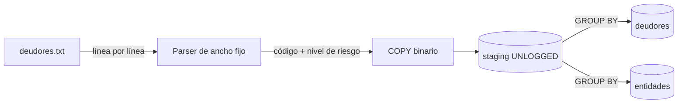

# ADR 0005 · Procesamiento: streaming, carga masiva y agrupación en la base

**En una frase:** el archivo se lee línea por línea, se carga en una tabla temporal con `COPY` y los resúmenes se calculan con un `GROUP BY` en PostgreSQL.

**Estado:** Aceptada

**Qué vas a encontrar**
1. [Contexto](#1-contexto)
2. [Decisión](#2-decisión)
3. [Alternativas consideradas](#3-alternativas-consideradas)
4. [Consecuencias](#4-consecuencias)

---

## 1. Contexto

- El archivo pesa 5,9 GB y tiene 34.385.567 líneas de ancho fijo (171 caracteres, Latin-1, CRLF).
- Hay 19.926.484 deudores distintos.
- El archivo **no viene ordenado**: las líneas de un mismo deudor están separadas por millones de líneas.

---

## 2. Decisión

1. **Lectura en streaming:** el archivo se lee de a una línea, como quien lee un libro renglón por renglón en vez de fotocopiarlo entero.
   - `StreamReader` con **`Encoding.Latin1`**: el archivo viene en Latin-1 (ISO-8859-1). Si se leyera con UTF-8, que es lo que usa .NET por defecto, letras como la `Ñ` se verían rotas (`YBA�EZ`).
   - **`IAsyncEnumerable`**: el método lector **entrega las líneas de a una** (`yield return`). El procesamiento toma una, la convierte, pide la siguiente, y así. Mientras espera al disco, el hilo queda libre para otras tareas (`async`).
   - Resultado: en memoria solo está la línea actual más un buffer de lectura de pocos KB. **Da igual si el archivo pesa 6 GB o 60 GB**: el consumo de memoria es el mismo.
2. **Parseo por posición:** se toman solo los campos 1, 2, 4, 6 y 7, y se valida que cada línea mida 171 caracteres. Las líneas inválidas se cuentan y se loguean.
3. **Carga masiva:** `COPY` binario de Npgsql a una tabla staging `UNLOGGED`.
4. **Agrupación en la base:** un `GROUP BY` calcula la situación máxima ([ADR 0001](0001-situacion-maxima-por-riesgo.md)) y las sumas en tablas nuevas, que reemplazan a `deudores` y `entidades` en una transacción ([ADR 0010](0010-reimportacion-reemplaza-resumenes.md)).
5. **Cancelación:** todo el proceso recibe un `CancellationToken`; si se detiene el servicio, la transacción se revierte y no quedan datos a medias.

---

## 3. Alternativas consideradas

| Alternativa                           | Por qué no                                                                                                                  | Por qué la opción elegida es mejor                                                                                                      |
| ------------------------------------- | --------------------------------------------------------------------------------------------------------------------------- | --------------------------------------------------------------------------------------------------------------------------------------- |
| Cargar el archivo entero en memoria   | 5,9 GB en RAM: lento y con riesgo de tirar el servicio                                                                      | Con streaming, la memoria es constante: una línea más los buffers, pese lo que pese el archivo                                          |
| Agrupar en memoria con un diccionario | Un `Dictionary` con 19,9 M de deudores ocupa unos 3 GB de RAM (estimación: ~140 bytes por deudor), y más al redimensionarse | PostgreSQL agrupa con `GROUP BY` usando la memoria que tiene asignada y, si no alcanza, sigue en disco; el worker no necesita GB de RAM |
| Insertar fila por fila                | Un viaje de ida y vuelta a la base por cada una de las 34 M de líneas                                                       | `COPY` manda todas las filas en un flujo continuo: órdenes de magnitud más rápido                                                       |

---

## 4. Consecuencias

**Lo que ganamos:**

- Memoria constante en el worker, pese lo que pese el archivo: con el archivo real no pasó de unos 76 MiB.
- La base hace lo que mejor sabe hacer: agrupar millones de filas.

**Lo que resignamos:**

- Durante la importación, `staging` ocupa unos 2 GB en disco (se vacía al terminar).
- Se procesa un archivo por vez, y siempre completo: cambiar una línea obliga a reprocesar todo.
