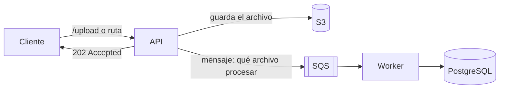

# ADR 0007 · Cola SQS entre la recepción y el procesamiento

**En una frase:** la API no procesa el archivo: deja un mensaje en una cola SQS (LocalStack) y un worker aparte lo toma y lo procesa.

**Estado:** Aceptada

**Qué vas a encontrar**
1. [Contexto](#1-contexto)
2. [Decisión](#2-decisión)
3. [Alternativas consideradas](#3-alternativas-consideradas)
4. [Consecuencias](#4-consecuencias)

---

## 1. Contexto

- Procesar el archivo completo lleva minutos. Una llamada HTTP no puede quedar esperando todo ese tiempo.
- El enunciado pide una solución de microservicios y suma como bonus "uso de SQS para procesamiento asíncrono".

---

## 2. Decisión



Paso a paso:

```text
API    ──(1) guarda el archivo──────────────→ S3
API    ──(2) deja el mensaje────────────────→ SQS: "el archivo está en s3://padron-archivos/importaciones/{id}/deudores.txt"

Worker ──(3) pregunta "¿hay mensajes?"──────→ SQS
Worker ←─(4) recibe el mensaje─────────────── SQS
Worker ──(5) lee el archivo de esa dirección→ S3
Worker ──(6) procesa y guarda───────────────→ PostgreSQL
Worker ──(7) borra el mensaje───────────────→ SQS
```

S3 y SQS solo guardan (el archivo y el mensaje, respectivamente); el único que actúa es el worker. Si el archivo entra por ruta local, se saltea el paso 1 y el mensaje lleva la ruta en lugar de la dirección de S3.

- La API responde **202 Accepted** apenas encola el pedido: "recibido, se va a procesar".
- El **worker** es un servicio aparte que lee la cola y procesa un archivo por vez.

### 2.1 Reintentos

- El worker **borra el mensaje solo después de terminar bien**. Si se cae a mitad de camino, no lo borra; cuando vence el tiempo de reserva (*visibility timeout*), el mensaje vuelve a la cola y se reintenta solo.
- Mientras procesa, el worker **renueva la reserva** (`ChangeMessageVisibility`), para que el mensaje no reaparezca mientras sigue trabajando.
- Después de **3 intentos fallidos** (configurable con `SQS_MAX_INTENTOS`), el mensaje pasa a una **cola de fallidos** (*dead-letter queue*) para revisarlo a mano, en vez de reintentarse para siempre.

### 2.2 Sin duplicados

SQS entrega cada mensaje **al menos una vez**: el mismo mensaje puede llegar dos veces, por ejemplo si el worker se cae después de guardar pero antes de borrarlo.

| Mecanismo                                                                                                                               | Qué evita                                                    |
| --------------------------------------------------------------------------------------------------------------------------------------- | ------------------------------------------------------------ |
| **Código único por importación**: la API lo crea, lo registra en la tabla `importaciones` (estado `pendiente`) y lo manda en el mensaje | —                                                            |
| El worker **ignora** los mensajes cuya importación ya está `completada`                                                                 | Reprocesar un mensaje duplicado                              |
| El estado pasa a `completada` **en la misma transacción** que guarda los resultados                                                     | Que queden los datos guardados sin marcar, o al revés        |
| **Lock en la base** (`pg_advisory_lock`), que PostgreSQL libera solo si el worker se cae                                                | Dos workers procesando lo mismo a la vez                     |
| **Procesamiento idempotente**: staging se vacía al empezar y los resultados se escriben en una transacción                              | Red de seguridad: procesar dos veces deja el mismo resultado |

### 2.3 Consulta del estado

`GET /importaciones/{id}` devuelve el estado (`pendiente`, `procesando`, `completada` o `fallida`) y, al terminar, el resumen. El id es el que devuelve la API junto con el 202.

### 2.4 Outbox: ningún pedido se pierde

La API guarda la importación en la base y después manda el mensaje a SQS. Si la cola falla, o la API se cae entre los dos pasos, el pedido quedaría `pendiente` sin mensaje. Para evitarlo se usa el patrón **Outbox**, con la propia tabla `importaciones`:

- La columna `encolada_en` dice si el mensaje ya se envió (`NULL` = falta enviarlo).
- La API intenta enviarlo enseguida. Si la cola falla, responde **202** igual: el pedido queda guardado.
- Un **repartidor** dentro de la API busca cada 10 segundos las `pendiente` sin encolar con más de 30 segundos, las envía y marca `encolada_en`.
- Primero envía y después marca: si se corta en el medio, el mensaje se reenvía y el worker ignora el duplicado (2.2). Nunca se pierde.

Se usa `importaciones` y no una tabla `outbox` aparte porque hay un solo tipo de mensaje y la fila ya tiene todo lo que lleva (id y archivo): una tabla genérica duplicaría datos sin dar más garantías. Si aparecieran otros tipos de mensaje, conviene pasar a una tabla `outbox` genérica.

---

## 3. Alternativas consideradas

| Alternativa                                            | Por qué no                                                                                         |
| ------------------------------------------------------ | -------------------------------------------------------------------------------------------------- |
| Procesar dentro del pedido HTTP                        | El cliente esperaría unos 4 minutos, y la conexión puede cortarse en el medio                      |
| Procesar en segundo plano dentro de la API, sin cola   | Si la API se reinicia, el pedido se pierde; y procesar 34 M de líneas compite con los pedidos HTTP |
| Una tabla `outbox` genérica, aparte de `importaciones` | Hay un solo tipo de mensaje: duplicaría datos sin dar más garantías (ver 2.4)                      |

---

## 4. Consecuencias

**Lo que ganamos:**

- La API responde en milisegundos, aunque el proceso tarde minutos.
- Reintentos y cola de fallidos los da SQS, sin código propio.
- El worker se puede escalar o reiniciar sin afectar a la API.
- Ningún pedido se pierde (Outbox) ni se procesa dos veces (consumidor idempotente).

**Lo que resignamos:**

- Más piezas que mantener: cola, worker, Outbox e idempotencia.
- El resultado no llega en la respuesta: hay que consultar el estado o esperar el webhook.
- LocalStack no guarda las colas al reiniciarse: en local, un reinicio puede perder un mensaje (con SQS real no pasa).
