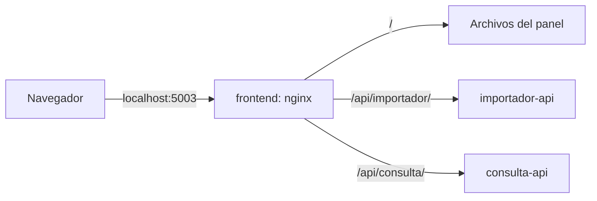

# ADR 0016 · Panel web: React y Vite, servido por nginx

**En una frase:** un panel web en React, compilado con Vite y servido por nginx en su propio contenedor, que usa las dos APIs a través de nginx, sin CORS.

**Estado:** Aceptada

**Qué vas a encontrar**
1. [Contexto](#1-contexto)
2. [Decisión](#2-decisión)
3. [Alternativas consideradas](#3-alternativas-consideradas)
4. [Consecuencias](#4-consecuencias)

---

## 1. Contexto

- Lo que tiene que hacer el panel: pedir una importación (por nombre o subiendo el archivo), seguir su estado y consultar deudores, entidades y el top.
- Todo eso ya lo hacen las APIs: el panel solo las usa, sin lógica de negocio propia.

---

## 2. Decisión

- **React + TypeScript**, compilado con **Vite**: el resultado son archivos estáticos (HTML, JS y CSS).
- **Un contenedor propio** (`frontend`, puerto 5003), con `nginx-unprivileged`: nginx sin permisos de administrador.
- **nginx también reenvía** los pedidos a las APIs: `/api/importador/` va a importador-api y `/api/consulta/` va a consulta-api.
- **El estado de las importaciones se consulta cada 2 segundos** (*polling*) a `GET /importaciones/{id}`, mientras alguna no terminó.
- **La subida muestra el avance** ("Subiendo X %"), porque con un archivo grande puede tardar minutos.
- Calidad: ESLint revisa el código y Vitest corre los tests.

---

## 3. Alternativas consideradas

| Alternativa                              | Por qué no                                                                                                         |
| ---------------------------------------- | ------------------------------------------------------------------------------------------------------------------ |
| Next.js                                  | Suma un servidor Node y renderizado del lado del servidor, que un panel que solo consume nuestras APIs no necesita |
| Habilitar CORS en las APIs               | Más configuración en cada API, y las abre a pedidos de otros orígenes; con nginx delante no hace falta             |
| Avisos en tiempo real (WebSockets o SSE) | Más infraestructura en la API; una importación tarda minutos, así que consultar cada 2 segundos alcanza            |

---

## 4. Consecuencias

**Lo que ganamos:**

- El panel es independiente: se cambia y se despliega sin tocar las APIs.
- Las APIs no cambiaron para soportarlo: el panel usa los mismos endpoints que cualquier cliente.

**Lo que resignamos:**

- El estado no se actualiza al instante: puede tardar hasta 2 segundos en reflejarse.
