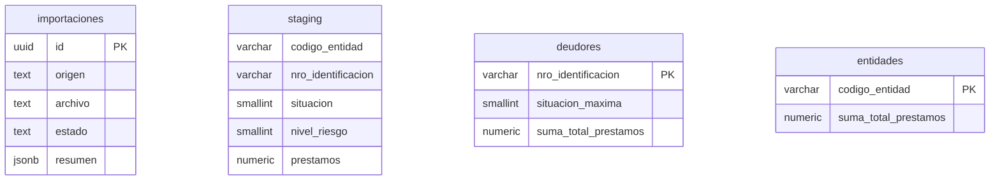
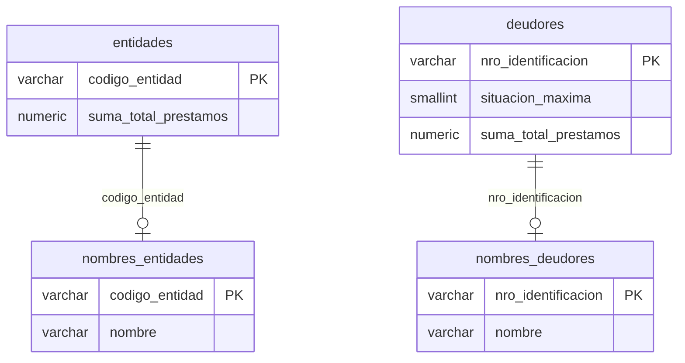
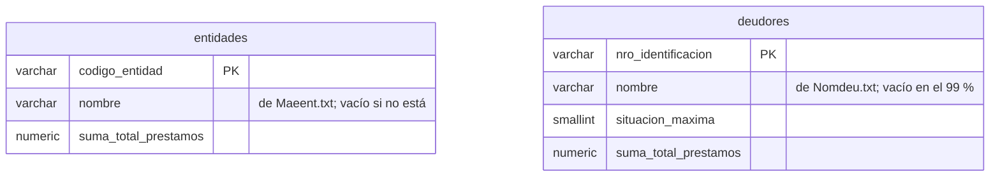

# ADR 0017 · No se cargan los nombres de entidades ni de deudores

**En una frase:** el sistema trabaja solo con códigos de entidad e identificaciones de deudores; los dos archivos de nombres que trae el ZIP del BCRA (`Maeent.txt` y `Nomdeu.txt`) no se cargan.

**Estado:** Aceptada

**Qué vas a encontrar**
1. [Contexto](#1-contexto)
2. [Decisión](#2-decisión)
3. [Alternativas consideradas](#3-alternativas-consideradas)
4. [Consecuencias](#4-consecuencias)
5. [Referencias](#5-referencias)

---

## 1. Contexto

Además de `deudores.txt`, el ZIP del BCRA trae dos archivos con nombres (\*):

| Archivo      | Qué tiene                                             | Formato                                          | Cobertura                              |
| ------------ | ----------------------------------------------------- | ------------------------------------------------ | -------------------------------------- |
| `Maeent.txt` | El nombre de cada entidad (banco, financiera…)        | Código (5 caracteres) + nombre (70)              | 485 de 485 entidades (100 %)           |
| `Nomdeu.txt` | El nombre de los deudores **no empadronados** en AFIP | Identificación (11) + nombre (55) + relleno (11) | 157.708 de 19.926.484 deudores (0,8 %) |

- Por ejemplo, en `Maeent.txt` la entidad `00007` es *BANCO DE GALICIA Y BUENOS AIRES S.A.U.*
- `Nomdeu.txt` cubre tan poco porque solo trae a quienes no están en el padrón de AFIP; el nombre del resto no lo publica el BCRA.
- El enunciado pide deudores y entidades **por identificación y por código**, y no menciona nombres: ni como requisito, ni como opcional, ni como bonus.

---

## 2. Decisión

- No se carga ninguno de los dos archivos.
- La API y el panel muestran el código de la entidad y la identificación del deudor.

Así quedan las tablas: ninguna se relaciona con otra por clave foránea. `deudores` y `entidades` se calculan desde `staging` y se reemplazan enteras en cada importación ([ADR 0010](0010-reimportacion-reemplaza-resumenes.md)); una clave foránea impediría borrarlas en el reemplazo.



```text
staging ──GROUP BY nro_identificacion──→ deudores
staging ──GROUP BY codigo_entidad──────→ entidades
```

---

## 3. Alternativas consideradas

### 3.1 Cargar los nombres en tablas aparte

Una tabla por archivo, relacionada **1 a 0..1** con la tabla que nombra: cada entidad o deudor tiene como mucho un nombre, y puede no tener ninguno.



Cada consulta tendría que unir las dos tablas (`LEFT JOIN`). La relación se mantendría por el código, sin clave foránea, por el mismo motivo del reemplazo.

### 3.2 Cargar los nombres como una columna más

Al armar las tablas nuevas en cada importación, el `GROUP BY` se une con los nombres y los guarda en la misma fila:



La consulta sigue leyendo una sola tabla: el trabajo se hace al importar, no en cada pedido. La desventaja: la columna de `Nomdeu.txt` quedaría vacía en el 99 % de las filas.

### 3.3 Por qué no se eligió ninguna

| Archivo      | Por qué no se carga                                                                                                                                                       |
| ------------ | ------------------------------------------------------------------------------------------------------------------------------------------------------------------------- |
| `Maeent.txt` | Sería útil para mostrar el nombre del banco, pero está fuera del alcance pedido: suma una migración, cambios en la importación, en la API y en el panel                   |
| `Nomdeu.txt` | Cubre menos del 1 % de los deudores, así que el nombre faltaría casi siempre. Además son **datos personales** (\*\*) que quedarían expuestos en una API sin autenticación |

---

## 4. Consecuencias

**Lo que ganamos:**

- Menos piezas: la importación lee un solo archivo y no hay tablas extra.
- El sistema no guarda ni expone nombres de personas.

**Lo que resignamos:**

- Para saber qué banco es la entidad `00007` hay que buscarlo aparte.

**Si se pidiera agregarlos**, conviene la alternativa 3.1, una tabla aparte por archivo, para los dos:

- **Son otra fuente**, con su propio ciclo: se actualizan sin reimportar los deudores, y no los toca el reemplazo de cada importación.
- **`Nomdeu.txt` cubre menos del 1 %** de los deudores: como columna, quedaría vacía en el 99 % de las filas y sumaría trabajo al armar la tabla de 20 millones.
- **Los datos personales quedan aislados:** la tabla de `Nomdeu.txt` puede tener permisos propios, para que solo la lea un usuario autorizado.
- **Unir al consultar no cuesta:** es una búsqueda por clave primaria.

`Nomdeu.txt`, además, solo convendría con autenticación en la API.

---

## 5. Referencias

(\*) Banco Central de la República Argentina. (2024). *Central de Deudores del Sistema Financiero: LEAME* [Documento incluido en el archivo 202311DEUDORES_20240122204012], diseños de registro de `Maeent.txt` y `Nomdeu.txt`.

(\*\*) Ley 25.326 de Protección de los Datos Personales. (2000). Boletín Oficial de la República Argentina. https://www.argentina.gob.ar/normativa/nacional/ley-25326-64790
