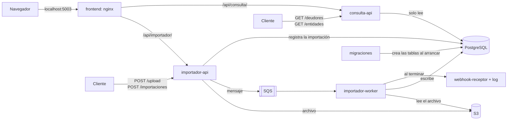

# Arquitectura

**En una frase:** tres servicios .NET chicos (dos APIs REST y un worker) que comparten PostgreSQL y usan S3 y SQS de LocalStack, más un panel web que usa las dos APIs; el importador escribe y la consulta solo lee.

**Qué vas a encontrar**
1. [Servicios](#1-servicios)
2. [Cómo se conectan](#2-cómo-se-conectan)
3. [Base de datos compartida](#3-base-de-datos-compartida)
4. [Estructura de la solución](#4-estructura-de-la-solución)
5. [Elecciones técnicas](#5-elecciones-técnicas)
6. [Lo que no hacemos](#6-lo-que-no-hacemos)

---

## 1. Servicios



| Servicio              | Qué hace                                                                                                                                                                          | Tipo                                 |
| --------------------- | --------------------------------------------------------------------------------------------------------------------------------------------------------------------------------- | ------------------------------------ |
| **frontend**          | Panel web: importar, seguir las importaciones y consultar. nginx sirve la app y reenvía `/api` a las dos APIs ([ADR 0016](adr/0016-panel-web.md)) | React + Vite, servido por nginx      |
| **importador-api**    | Recibe el archivo (`/upload` o ruta local), registra la importación y la encola                                                                                                   | API REST (ASP.NET Core, Minimal API) |
| **importador-worker** | Lee la cola, procesa el archivo y notifica                                                                                                                                        | Worker Service (`BackgroundService`) |
| **consulta-api**      | Responde las consultas de deudores, entidades y el top, con filtro por situación                                                                                                  | API REST (ASP.NET Core, Minimal API) |
| **postgres**          | Base de datos                                                                                                                                                                     | Imagen oficial                       |
| **localstack**        | Simula S3 y SQS                                                                                                                                                                   | Imagen oficial                       |
| **webhook-receptor**  | Recibe el webhook en la demo y lo muestra en su log                                                                                                                               | Imagen existente                     |
| **migraciones**       | Corre una vez al levantar: crea y versiona las tablas ([ADR 0013](adr/0013-migraciones-dbup.md))                                                  | Consola .NET con DbUp                |

**Por qué tres servicios .NET y no dos:**
- **No se molestan:** subir 6 GB no afecta el tiempo de respuesta de las consultas.
- **Se escalan por separado:** importar es pesado y esporádico; consultar es liviano y frecuente.
- **Más seguro:** la consulta usa un usuario de base de **solo lectura**.
- **Coincide con el enunciado**, que separa "Importador de Archivo" y "API de Consulta".

Separar el servicio que escribe del que solo lee es la idea de **CQRS**, aplicada a nivel de servicios, sin librerías.

---

## 2. Cómo se conectan

| Desde             | Hacia            | Para qué                                                                                                                    |
| ----------------- | ---------------- | --------------------------------------------------------------------------------------------------------------------------- |
| frontend          | importador-api   | Pedir importaciones y seguir su estado (nginx reenvía `/api/importador/`)                                                   |
| frontend          | consulta-api     | Consultar deudores, entidades y el top (nginx reenvía `/api/consulta/`)                                                     |
| importador-api    | S3               | Guardar el archivo subido (multipart) ([ADR 0006](adr/0006-entrada-del-archivo.md))         |
| importador-api    | PostgreSQL       | Registrar la importación con su código único ([ADR 0007](adr/0007-cola-sqs.md))             |
| importador-api    | SQS              | Encolar el pedido; si la cola falla, el repartidor lo reenvía después (Outbox)                                              |
| importador-worker | SQS              | Recibir pedidos y borrarlos al terminar                                                                                     |
| importador-worker | S3 o disco       | Leer el archivo en streaming ([ADR 0005](adr/0005-procesamiento-streaming-copy-staging.md)) |
| importador-worker | PostgreSQL       | Cargar staging y escribir los resúmenes                                                                                     |
| importador-worker | webhook-receptor | Avisar que terminó ([ADR 0008](adr/0008-notificacion.md))                                   |
| consulta-api      | PostgreSQL       | Leer `deudores` y `entidades`                                                                                               |

Los servicios .NET **no se llaman entre sí**: se comunican solo a través de SQS y de la base. El panel solo habla con las APIs, a través de nginx.

---

## 3. Base de datos compartida

Los tres servicios usan la misma PostgreSQL, pero cada tabla tiene **un solo dueño que escribe**:

| Tabla                    | Escribe                 | Lee               |
| ------------------------ | ----------------------- | ----------------- |
| `importaciones`          | importador-api y worker | importador-api    |
| `staging`                | importador-worker       | importador-worker |
| `deudores` y `entidades` | importador-worker       | consulta-api      |

Una base por servicio duplicaría 20 M de filas sin beneficio.

---

## 4. Estructura de la solución

Todo vive en **un solo repositorio** (monorepo): cada servicio sigue siendo independiente porque tiene su propia imagen y su propio contenedor ([ADR 0015](adr/0015-monorepo.md)).

```text
src/
├─ PadronDeudores.Dominio/            ← reglas de negocio: Situacion, NivelDeRiesgo, lectura de una línea
├─ PadronDeudores.Infraestructura/    ← todo lo que habla con el mundo de afuera, y la configuración
│  ├─ Archivos/                       ← lectura del archivo, disco y S3
│  ├─ Logs/                           ← configuración de Serilog
│  ├─ Mensajeria/                     ← cola SQS
│  └─ Persistencia/                   ← PostgreSQL: repositorios, staging y table swap
├─ PadronDeudores.Importador.Api/
│  └─ Importaciones/                  ← upload, ruta local, estado y repartidor (Outbox)
├─ PadronDeudores.Importador.Worker/
│  ├─ Procesamiento/
│  └─ Notificaciones/                 ← webhook
├─ PadronDeudores.Consulta.Api/
│  ├─ Deudores/
│  └─ Entidades/
└─ PadronDeudores.Migraciones/       ← crea y versiona las tablas con DbUp (ADR 0013)
   └─ Scripts/
tests/
├─ PadronDeudores.Dominio.Tests/      ← unit tests
└─ PadronDeudores.IntegracionTests/   ← con PostgreSQL y LocalStack reales (Testcontainers)
frontend/                             ← panel web
└─ src/
   ├─ api/                            ← cliente HTTP de las dos APIs
   ├─ comunes/                        ← componentes compartidos
   ├─ consultas/                      ← deudores, entidades y top
   ├─ encabezado/                     ← título y salud de las APIs
   └─ importaciones/                  ← importar y seguir el estado
```

- **Dominio no depende de nada:** ni de la base ni de AWS. Se testea solo y rápido.
- Los servicios dependen de Dominio e Infraestructura, nunca entre ellos.
- Migraciones es una herramienta: corre una vez, crea las tablas y termina; no depende de ningún otro proyecto.
- Adentro de cada servicio, **una carpeta por funcionalidad**: todo lo de "consultar deudores" está en `Deudores/`. El panel sigue el mismo criterio: `importaciones/`, `consultas/`.

---

## 5. Elecciones técnicas

| Tema                     | Elección                                                                                                                        | Por qué                                               |
| ------------------------ | ------------------------------------------------------------------------------------------------------------------------------- | ----------------------------------------------------- |
| Endpoints                | Minimal APIs                                                                                                                    | Estándar en .NET moderno, con poco código             |
| Acceso a datos           | Dapper para consultas; Npgsql directo para `COPY`                                                                               | SQL explícito y rápido                                |
| Creación de tablas       | Migraciones versionadas con DbUp ([ADR 0013](adr/0013-migraciones-dbup.md))                     | Solo aplica las que faltan; SQL explícito             |
| Logs                     | Serilog, JSON por consola                                                                                                       | Logs estructurados con duración y resumen             |
| Documentación de la API  | OpenAPI de .NET + pantalla para probar los endpoints                                                                            | Endpoints documentados y probables desde el navegador |
| Configuración            | Options pattern, valores desde `.env`                                                                                           | Tipada y validada al arrancar                         |
| Salud                    | Health checks (`/health/live` y `/health/ready`)                                                                                | Docker Compose espera a que cada servicio esté listo  |
| Confiabilidad de la cola | Outbox con la tabla `importaciones` y consumidor idempotente ([ADR 0007](adr/0007-cola-sqs.md)) | Ningún pedido se pierde ni se procesa dos veces       |
| Panel web                | React + Vite, servido por nginx ([ADR 0016](adr/0016-panel-web.md))                             | Independiente de las APIs y sin CORS                  |

---

## 6. Lo que no hacemos

| No hacemos                                    | Por qué                                                                  |
| --------------------------------------------- | ------------------------------------------------------------------------ |
| MediatR, comandos y handlers                  | Ceremonia para servicios de 2 o 3 endpoints                              |
| Entity Framework                              | No aporta para un `COPY` y un `GROUP BY`                                 |
| Repositorios genéricos e interfaces para todo | Solo interfaces donde hagan falta para testear                           |
| Capa "Application" separada                   | Con tan poca lógica quedaría vacía                                       |
| Una base de datos por servicio                | Duplicaría 20 M de filas sin beneficio                                   |
| Una tabla `outbox` genérica                   | Hay un solo tipo de mensaje: alcanza con la propia tabla `importaciones` |
